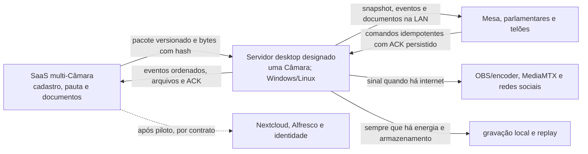

# Plano mestre de desenvolvimento — edocBR Plenário

**Versão:** 1.0 · **Base de verificação:** 07/11/2026 · **Estado:** plano vigente do produto. Este documento substitui os planos cronológicos anteriores como referência de prioridade; não apaga suas decisões e provas. O [índice documental](README.md) explica onde consultar cada assunto e como manter o conjunto coerente.

## 1. Resultado que o produto deve entregar

O edocBR Plenário será um SaaS multi-Câmara para preparar sessões e documentos na web, conduzir os trabalhos com identidade e regras da própria Câmara, registrar presença, fala, votação e ata, operar telões e dispositivos parlamentares, transmitir e gravar a sessão e publicar somente os fatos aprovados. A operação de cada Câmara deve ser configurável, auditável e isolada.

O modelo alvo inclui **um servidor desktop local designado por Câmara**, em Windows ou Linux. Ele importa automaticamente da web a sessão completa e seus documentos, atende Mesa, parlamentares e telões na rede local, conduz os atos sob autoridade única e sincroniza eventos e arquivos com o SaaS. Se a internet da Câmara cair, uma sessão já preparada poderá continuar na LAN **somente depois** de o modo local passar por segurança, ensaio e aceite institucional. A transmissão para redes sociais precisa de internet; a gravação local continua durante a queda. [ADR-027](adr/ADR-027-saas-nucleo-local-operacao-offline.md) detalha a decisão.

**Ordem de produto acordada:** concluir o núcleo Plenário e o piloto antes de escrever nos serviços institucionais. Nextcloud, Alfresco, diretório e assinatura entram por contratos e conectores nas fases finais. O Plenário preserva a autoria e o resultado dos atos deliberativos; uma integração externa não pode comandar voto ou substituir um resultado encerrado.

### Critérios de verdade

| Estado | O que comprova | O que ainda não comprova |
|---|---|---|
| Implementado | Código, contrato e teste automatizado no repositório | Uso em equipamento, rede e regimento reais |
| Ensaiado | Jornada reproduzida com dados fictícios e evidência | Aceite de uma Câmara para ato oficial |
| Homologado | Ensaio no ambiente alvo, comparação humana, responsáveis e aceite registrados | Disponibilidade futura sem monitoramento e rotina operacional |
| Em operação | Release identificada, suporte, alertas, backup, recuperação e revisão periódica ativos | Novas modalidades ou Câmaras sem seus próprios gates |

Uma tela, rota, CI verde ou resposta HTTP 200 não muda sozinha o estado para “homologado”. Cada gate abaixo precisa de versão, ambiente, participantes, resultado, falhas, correção e referência de evidência.

## 2. Estado verificável em 07/11/2026

| Frente | Estado atual | Lacuna para uso real |
|---|---|---|
| SaaS web e multi-Câmara | Tenants, papéis, marca/configuração, cadastros, sessões, pauta, presença, voto nominal/simbólico, ata, portal, APIs, outbox e auditoria implementados e ensaiados em partes | Validar isolamento e operação prolongada com Câmaras, papéis e carga representativos; fechar regras institucionais |
| Infraestrutura | VPS dedicada de **homologação sintética** em `edocbrplenario.com.br`, PostgreSQL 16, Redis, app e workers, TLS, promoção local → GitHub → VPS com CI | Backup cifrado recorrente em destino durável, retenção, alerta a responsável, comutação e metas de recuperação pactuadas |
| Monitoramento | Observador externo agendado verifica HTTPS, banco, app, realtime, webhooks e scheduler; parada controlada de webhooks foi detectada | Canal de notificação e escalonamento, histórico/SLO, correio quando configurado, host e disco |
| Recuperação | Pacote banco+arquivos conferido; app autenticado, PostgreSQL e mídia restaurados em computador independente com dados fictícios | Rotina recorrente e recuperação operacional após perda do host, com DNS, identidade, armazenamento e volume representativo |
| Mucuri | Cadastro público preparatório, fotos e identidade visual; pré-voo registra `automaticReady: false` | Conferência oficial de composição, regimento, responsáveis, usuários, comunicação, audiovisual e aceite |
| Audiovisual | RTMP/RTMPS, múltiplos destinos sintéticos, observação, gravação e replay ensaiados | Câmeras, mesa de áudio, banda, canal e chave institucionais; observação pública em outra rede |
| Desktop e offline | Direção funcional e arquitetura descritas no ADR-027 | Não há instalador, serviço local, pacote assinado, autoridade exclusiva nem sincronização centro ↔ desktop; votação offline oficial permanece bloqueada |
| Integrações edocBR | Contrato proposto; API, webhooks e outbox genéricos existentes | Fonte de verdade e adaptadores Nextcloud/Alfresco/identidade/assinatura ainda não aprovados nem ativados |

As provas recentes estão em [recuperação independente](etapas/045-recuperacao-stack-postgres.md), [observador externo](etapas/045-observador-publico-externo.md), [deliberação em duas instâncias](etapas/049-deliberacao-postgres-duas-instancias.md) e [transmissão de laboratório](etapas/052-repeticao-laboratorio-transmissao-2026-11-05.md). O domínio público atual é **staging com tenant fictício**, não portal institucional de Mucuri.

## 3. Arquitetura alvo e limites de autoridade

1. **SaaS central:** Next.js/React/TypeScript, domínio transacional e Prisma/PostgreSQL. Redis e workers separados sustentam tempo real, filas, webhooks, agenda e correio. Cada tabela, arquivo, evento, chave e job deve ter escopo de Câmara comprovado. A VPS atual é ponto de partida; capacidade para várias Câmaras exige medição antes de expansão.
2. **Preparação web:** secretaria cadastra toda sessão, matéria, pauta, convocação e documento na web. Revisões são imutáveis e associadas à configuração regimental aprovada. O desktop não cria pauta oficial autônoma durante ausência de internet.
3. **Servidor local:** serviço independente da janela do operador, uma Câmara por instalação, banco e acervo locais, API e tempo real na LAN. Um único desktop detém a autoridade de cada sessão; o centro rejeita mutações concorrentes enquanto a autoridade local vigora. Promoção de reserva exige bloquear o anterior e conferir o último evento confirmado.
4. **Dispositivos:** interface responsiva/PWA servida pelo desktop. PDFs podem ser cacheados para leitura; presença, fala e voto só valem após ACK persistido pela API local. Reconexão usa cursor e snapshot quando houver lacuna. Dispositivo isolado do servidor não produz ato oficial.
5. **Sincronização:** web → desktop envia manifesto, revisão e todos os bytes necessários com SHA-256; desktop → web envia sequência por sessão, ator/dispositivo, `commandId`, auditoria e arquivos com hash. ACK durável, deduplicação e quarentena de conflito; nunca “última gravação vence” para voto. O portal sinaliza horário e atraso da última sincronização.
6. **Audiovisual:** operador audiovisual controla encoder/OBS e MediaMTX; o Plenário distingue sinal local, ingestão remota e página pública observada. Link social só é publicado após checagem de vídeo **e áudio** fora da rede da Câmara. Voto e apuração não dependem do pipeline de vídeo.

**Stack desktop a decidir por protótipo:** o ADR-027 propõe avaliar Tauri 2 para a janela/instalador; o serviço deve sobreviver ao fechamento da janela. Comparar PostgreSQL e SQLite locais com concorrência, falha de energia, backup, assinatura de instalador e operação Windows/Linux antes de fixar a escolha. Nenhum banco será replicado por cópia de tabelas entre centro e Câmara. TLS e endereço LAN sem DNS externo, identidade de dispositivo, credencial offline com prazo, revogação, criptografia em repouso e backup conjunto são requisitos de entrada, não melhorias opcionais.

## 4. Plano de execução em ordem de dependência

As fases **P0–P13** são a sequência atual; os números 045–057 identificam o histórico de entregas anteriores. Engenharia pode avançar em tarefas técnicas paralelas, mas um gate oficial não pode ser antecipado por outra frente.

| Fase | Estado e correspondência | Entrega de desenvolvimento | Gate de saída verificável |
|---|---|---|---|
| **P0 — linha de base** | Esta revisão; histórico 043–045 | Plano único, índice, matriz requisito→código→teste→prova, classificação de legados, baseline de CI e ambiente | Documentação navegável, pendências sem duplicidade de autoridade e CI do commit de referência verde |
| **P1 — operação SaaS** | Em homologação técnica; 045 | Backup cifrado recorrente fora da VPS, retenção, verificação e teste periódico; alerta externo com responsável; carga/falhas, logs, segurança e runbook de comutação | Recuperação completa a partir de cópia durável em host novo, RTO/RPO e capacidade medidos contra metas pactuadas, nenhum dado de Câmara real em staging sintética |
| **P2 — configuração por Câmara** | Código parcial; 046 | Onboarding configurável de marca, legislatura, mandatos, Mesa, partidos/emblemas, quóruns, maiorias, impedimentos, prazos, papéis, retenção, publicação, mídia e recursos por plano; revisão imutável | Dois tenants com regras e aparência distintas, negativos de acesso, matriz regimental e composição aprovadas por cada Câmara |
| **P3 — preparação web** | Código/ensaios parciais; 047 | Criar sessão, numeração concorrente, matérias, documentos, versões da pauta, convocação, entrega/ciência e prontidão; sanar anexos externos não baixados | Sessão fictícia completa com bytes e hashes verificáveis, revisão publicada e comprovante do canal de comunicação; nenhuma alteração silenciosa |
| **P4 — contrato do núcleo local** | Planejado; ADR-027/050 | Extrair comandos determinísticos do servidor atual; definir pacote de sessão, esquema/versionamento, assinatura, propriedade, eventos, ACK e conflitos; modelo de ameaça | Mesmos casos de presença/voto/ata têm o mesmo resultado em dois executores de teste; contrato versionado e testes negativos de autoridade |
| **P5 — desktop e distribuição LAN** | Não implementado; ADR-027 | Serviço Windows/Linux independente da janela, banco/acervo locais, importação automática integral, estados de prontidão, API LAN/TLS, identidade de dispositivo, snapshots e documentos para tablets/celulares/notebooks | Instalar nos dois SO; pacote incompleto bloqueia abertura; três classes de dispositivo recebem revisão idêntica; fechar janela não derruba serviço |
| **P6 — autoridade e sincronização** | Não implementado; ADR-027/050 | Escritor único local, sequência durável, outbox, transmissão por partes, ACK, dedupe, reconciliação e promoção controlada de reserva; atualizações web entram como revisão pendente | Perda/retorno de WAN, LAN, SaaS e energia não duplicam nem perdem atos confirmados; conflito entra em quarentena; portal informa atraso real |
| **P7 — plenário e votação** | Web ensaiada; local pendente; 048–050 | Presença, suplência, impedimento, quórum por ato, fala, telão, nominal/simbólica, recibo, apuração e anulação no executor autorizado; acessibilidade e recomposição | 100% dos casos regimentais aprovados conferidos por cálculo humano independente; duas telas e dispositivos reais; isolamento entre Câmaras; offline só após gate P6 |
| **P8 — ata e transparência** | Fluxo web parcial; 051 | Fechamento, minuta, revisão, assinatura aplicável, retificação, publicação segregada, portal, dados abertos e vínculo ao replay; centro só publica após reconciliação local | Texto/versão/hash/autoria conferidos; publicação autorizada por segundo papel; conteúdo público e retenção aprovados |
| **P9 — transmissão e gravação** | Laboratório sintético; 052 | Câmera/áudio→encoder/OBS→MediaMTX→RTMPS, dois destinos, perda/retorno, monitoramento, gravação local, replay e observação pública | Áudio e vídeo vistos em outra rede, queda de um destino não afeta voto nem outro destino, replay íntegro e operador assina a prova |
| **P10 — segurança e operação local** | Planejado; 045/050 | Instalação assinada, atualização/rollback fora de sessão, proteção de chave/banco, backup local, certificado LAN, revogação de dispositivo, teste de invasão e recuperação de desktop | Windows/Linux e reserva ensaiados; nenhuma dupla autoridade; incidentes e suspensão documentados; revisão de segurança aprovada |
| **P11 — piloto assistido** | Preparado, não iniciado; 053 | Mucuri: dados e regras aprovados, contas nominais, equipamentos, treinamento, sessão fictícia longa e sessão assistida com suporte e plano de suspensão | Pré-voo coerente, aceites técnico, legislativo, jurídico, acessibilidade e audiovisual; qualquer falha bloqueante reabre o gate |
| **P12 — integrações edocBR** | Planejado para após P11; 054–056 | Fonte de verdade por campo/ato; leitura Nextcloud e Alfresco com ACL e ID estável; entrega aprovada por outbox, ACK, hash, retry/dedupe, reconciliação e reversão; identidade/assinatura por contrato | Fluxo em homologação com negativos entre tenants, divergências visíveis e aceite TI + secretaria; indisponibilidade externa não altera votação |
| **P13 — expansão SaaS** | Planejado; 057 | Onboarding repetível, migrações por tenant, observabilidade/SLO, suporte auditável, treinamento, capacidade multi-Câmara, faturamento e contratos operacionais | Segunda Câmara entra sem código específico e sem vazamento; restauração e releases periódicos comprovados |

### Gates transversais de cada entrega

- **Produto:** história do papel afetado, erro e estado de recuperação, acessibilidade, desktop/móvel/telão e instrução de uso atualizada.
- **Domínio:** migração aditiva e reversível quando houver, configuração por Câmara, auditoria, idempotência, versionamento e casos de regra negativos.
- **Segurança:** autenticação e autorização no servidor, dois tenants nos testes, tratamento de segredos, logs sem dados sensíveis, cadeia de confiança dos arquivos e dispositivos.
- **Operação:** ambiente limpo, falha/retorno, backup/restore quando mexer em estado durável, observador externo, release por SHA e plano de reversão.
- **Evidência:** teste automatizado relevante, ensaio reproduzível, limite do teste, responsável pela conferência humana e decisão de aceite quando o ato for oficial.

## 5. Sequência de releases e definição de pronto

| Marco | Pode fazer | Não deve ser anunciado como |
|---|---|---|
| **R0 — laboratório** | Dados fictícios, demos e testes locais | Sessão oficial ou continuidade offline |
| **R1 — staging SaaS** | Homologar infraestrutura e funções conectadas em VPS sintética | Produção multi-Câmara, backup contratual ou aceite de Mucuri |
| **R2 — piloto local** | Sessão completa importada e conduzida por desktop em ambiente de teste, inclusive quedas controladas | Operação offline oficial antes dos gates P6/P10/P11 |
| **R3 — piloto institucional assistido** | Uso delimitado por Câmara, regras, infraestrutura e responsáveis aprovados; suspensão quando ocorrer falha fora do escopo homologado | Expansão automática para outras Câmaras |
| **R4 — produto integrado** | Conectores e fluxo documental após P12; segunda Câmara após P13 | Escrita bilateral sem fonte de verdade ou assinatura presumida |

O voto secreto permanece **bloqueado** até projeto de sigilo próprio, modelo de ameaça e revisão independente; não é requisito implícito para liberar voto nominal/simbólico. A decisão sobre incluir votação offline no primeiro piloto deve ser tomada **antes** do escopo R3. Como o usuário definiu o servidor local como parte do produto, P4–P6/P10 são obrigatórios para declarar o **produto alvo completo**, mesmo que um piloto estritamente conectado seja autorizado antes com contingência de suspensão explícita.

## 6. Qualidade, capacidade e indicadores

O pipeline local → PR → CI → `main` → VPS permanece obrigatório para releases do SaaS. A promoção fixa SHA, migração e imagem, compara versão dos serviços e consulta prontidão; rollback de banco não é automático. Mudanças de desktop exigirão pipelines próprios de build Windows/Linux, assinatura, verificação de artefato e atualização controlada.

**Matriz mínima:** contrato e unidade para regras; integração PostgreSQL e arquivos; API por papel e por dois tenants; navegador Mesa/parlamentar/telão; duas instâncias para concorrência; LAN/WAN/energia/worker/encoder sob falha; pacote e sync com bytes adulterados; restauração em host novo; acessibilidade por teclado e leitor de tela humano; operação longa com carga representativa. O caso nominal e simbólico deve bater com livro independente, não apenas com cálculo feito pela mesma função do sistema.

**Medir e pactuar antes de R3:** sessões simultâneas por Câmara, dispositivos por sessão, tempo de comando e recomposição, atraso de sincronização/portal, disponibilidade por serviço, idade do último backup íntegro, RPO, RTO, retenção, espaço e banda de vídeo, latência de alerta, tempo de recuperação de mídia e incidentes de acessibilidade. Nenhum número de laboratório deste repositório deve virar SLA sem carga, equipe e ambiente definidos.

## 7. Decisões e dependências externas

| Decisão/entrada | Responsável | Necessária antes de |
|---|---|---|
| Regimento, composição, Mesa, casos de apuração, política de voto, textos e responsáveis de Mucuri | Secretaria, Presidência e jurídico | P2/P7/P11 oficiais |
| Canal de convocação, contas nominais, MFA e política de dispositivo | Câmara/TI | P3/P5/P11 |
| Computador local, energia/rede LAN, certificado/dispositivos e reserva; tempo máximo sem WAN | Câmara + operação edocBR | P5/P6/P10/P11 |
| Destino durável de backup, chave com custódia, retenção, canal de alerta e metas RTO/RPO | Operação SaaS/TI | Fechar P1 e R3 |
| Câmeras, áudio, banda, conta/chave social e observador em outra rede | Audiovisual/TI | P9/P11 |
| Fonte de verdade ATA/PAUTA, IDs, ACL, assinatura e ambiente de teste Nextcloud/Alfresco | TI + secretaria + jurídico | P12 |

Dados públicos preparatórios de Mucuri não substituem validação de mandato, foto/emblema, regra ou autorização de publicação. A configuração deve ser versionada e aceita; não codificar o regimento de Mucuri como regra global do SaaS.

## 8. Equipe, cadência e controle de mudanças

Uma equipe real precisa cobrir **produto legislativo**, **engenharia web/domínio**, **desktop e sincronização**, **QA/acessibilidade**, **operação e segurança**, **audiovisual** e **suporte**. Uma pessoa pode acumular funções durante desenvolvimento, mas ninguém deve aprovar sozinho regra regimental, resultado, publicação e recuperação que também implementou. Secretaria, Mesa, TI e audiovisual da Câmara são validadores do piloto, não substitutos dos testes de engenharia.

Trabalhar em incrementos pequenos com demonstração e evidência no fim de cada ciclo. Antes de cada ciclo, selecionar uma fase/gate, fixar casos de aceitação e dados de teste; ao fechar, registrar SHA, CI, ensaio, defeitos, decisão e próximo bloqueio. A ordem de dependência P0→P13 prevalece sobre contagem de tarefas. Estimativa de prazo e orçamento exige equipe disponível, escopo do primeiro piloto, hardware local, conta social, destino de backup e responsáveis institucionais definidos; o plano não inventa data de entrada em produção.

Mudanças de regra aprovada, autoridade de sessão, formato de pacote ou publicação exigem ADR ou revisão de contrato, migração compatível, testes de versão anterior/nova e plano de reversão. Incidente de produção reabre o gate afetado até correção e nova prova. O histórico de decisão permanece em Git; segredos e aceites pessoais ficam em repositório institucional privado com referências, não em commits.

## 9. Próximas execuções concretas

1. **Fechar P0 nesta revisão:** publicar índice, plano mestre, hierarquia dos legados e matriz de estado. Conferir links e CI; não implantar documentação como se fosse nova versão do app.
2. **Avançar P1:** escolher destino independente durável e custódia de chave; automatizar backup cifrado, retenção, verificação, alerta e restauração periódica. Executar falha global/comutação com carga sintética representativa e registrar metas pactuadas. O restore independente de app+banco+arquivos já passou como ensaio pontual.
3. **Iniciar P4 sem esperar conta institucional:** escrever contrato versionado do pacote de sessão, manifesto de documentos, comandos/eventos, autoridade, ACK e quarentena; usar tenant fictício e comparar o motor web atual. Fazer modelo de ameaça antes de abrir API LAN.
4. **Preparar P2/P3 com Mucuri:** recolher e conferir formulários de [aceite](aceite/README.md), responsáveis e canais; seguir com fixtures sintéticas enquanto não houver aprovação. Não converter o pré-voo bloqueado em pronto por preenchimento presumido.
5. **P9 em paralelo técnico:** ensaiar encoder, gravação e falha de destinos com mídia fictícia; a prova em canal institucional aguarda conta e equipamento.

O [registro de etapas](etapas/README.md) guarda mudança, comando, resultado e limite de cada incremento. A [matriz viva](MATRIZ-ENTREGA.md) liga requisito, implementação, teste e aceite. O [pacote de homologação](HOMOLOGACAO-PACOTE-EXECUCAO.md) é roteiro de ensaio, não atestado de aceite. A organização e as lacunas documentais estão no [índice](README.md).
