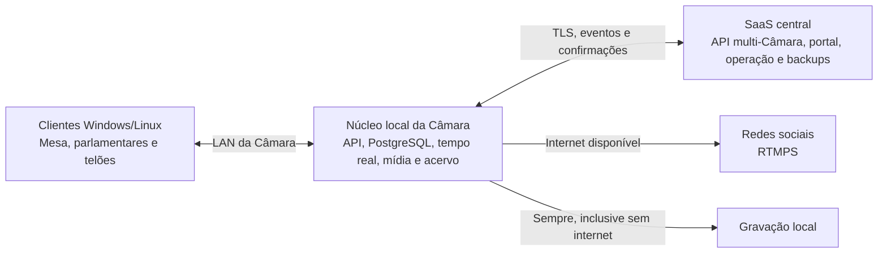

# ADR-027 — SaaS central com núcleo local para operação sem internet

**Status:** proposta para decisão · **Data:** 06/11/2026. Este documento não habilita votação offline nem altera o aceite do piloto. Complementa o [ADR-001](ADR-001-adaptacao-arquitetura-sandbox.md), que adiou o agente local, e a [fase 050](../etapas/050-sigilo-continuidade-excepcional.md), que hoje suspende atos digitais durante perda de conectividade.

## Problema e objetivo

Uma VPS pode hospedar o SaaS de várias Câmaras, com isolamento por `tenantId`, PostgreSQL, serviços de tempo real, administração, portal e backup. Ela não consegue sustentar uma sessão oficial quando a Câmara perde a ligação com a internet. Um aplicativo instalado em cada computador mantém a interface aberta, mas, se cada cópia puder votar isoladamente, surgem múltiplas versões da presença, da pauta e do resultado. O objetivo proposto é que **a sessão continue na rede local da Câmara mesmo quando a internet falhar**, com uma única autoridade para cada ato e sincronização posterior verificável.

Uma VPS é um ponto de partida de implantação, não um compromisso de capacidade para todas as Câmaras. Antes da expansão, medir sessões simultâneas, conexões de telão/portal, largura de banda, backup/restauração e disponibilidade; separar banco, armazenamento e redundância conforme a carga observada. O isolamento lógico por `tenantId` precisa continuar comprovado em APIs, arquivos, eventos e backups.

## Topologia proposta

| Camada | Responsabilidade | Condição sem internet |
|---|---|---|
| SaaS central | Cadastro e configuração versionada por Câmara, administração da plataforma, portal público, auditoria consolidada e distribuição de atualizações | Mostra último estado sincronizado com aviso de atraso; não aceita comandos para sessão sob autoridade local |
| Núcleo local por Câmara | Autoridade exclusiva da sessão ativa, banco e arquivos locais, API da LAN, tempo real, telão, gravação, fila de sincronização | Mantém operação na LAN, desde que energia, núcleo e rede local permaneçam disponíveis |
| Cliente Windows/Linux | Interface da Mesa, secretaria, parlamentar e telão; autenticação no núcleo da Câmara | Continua conectado ao núcleo pela LAN; sozinho, sem LAN, não executa ato coletivo oficial |

O núcleo deve ser um serviço em equipamento dedicado da Câmara, com armazenamento e energia protegidos, e não uma cópia de banco em cada cliente. A instância central é multi-tenant; cada núcleo contém **apenas um tenant**. O primeiro piloto técnico deve usar o mesmo domínio de comandos do servidor atual, mas o deploy local e o protocolo de sincronização são novas entregas. Nenhum banco PostgreSQL ou SQLite será replicado por cópia de tabelas entre centro e Câmara.

O acesso na LAN também precisa de TLS, identidade de dispositivo, usuário nominal, autorização por papel, expiração de credenciais offline e trilha auditável. A Câmara deve poder revogar dispositivos perdidos quando houver conexão; durante uma desconexão prolongada, a janela de autorização previamente aprovada limita esse risco. O núcleo guarda chaves fora do banco e requer backup conjunto de banco e arquivos, criptografia do armazenamento e restauração ensaiada. Esses mecanismos entram no modelo de ameaça da fase 050.

## Autoridade e sincronização

1. **Antes da sessão:** o centro entrega ao núcleo um pacote versionado e assinado com `tenantId`, `sessionId`, pauta e anexos com hashes, composição, vínculos, regras regimentais aprovadas, usuários/dispositivos autorizados, versão de esquema e janela de validade. O núcleo valida e confirma prontidão. Sessões e regras não preparadas não são criadas como atos oficiais durante a desconexão.
2. **Durante a sessão:** o núcleo é o único escritor de presença, fala, votação, apuração, telão e encerramento daquela sessão. O centro rejeita mutações concorrentes, mesmo se a internet retornar no meio da sessão. Cada comando tem ator, dispositivo, `commandId`, versão esperada, horário observado e resultado. O núcleo grava transação, auditoria e evento de saída antes de confirmar ao cliente.
3. **Após reconectar:** o núcleo envia eventos ordenados por `(tenantId, sessionId, sequência)`; o centro valida identidade do núcleo, versão, encadeamento/hash, idempotência e regras, persiste e devolve o maior número confirmado. Eventos pendentes permanecem duráveis até confirmação. Divergência entra em quarentena para conferência humana; **não** se resolve votação por “última gravação vence”.
4. **Fechamento e publicação:** o resultado é conferido localmente e no centro. A publicação externa e a integração futura com outros sistemas exigem reconciliação concluída e o fluxo de aprovação correspondente. Um ACK de transporte não equivale a aceite da ata nem a assinatura institucional.
5. **Recuperação:** a autoridade de uma sessão não migra automaticamente para outro núcleo. Restaurar backup ou ativar reserva exige procedimento de promoção com bloqueio do anterior, identificação de último evento confirmado e conferência de lacunas, para impedir dois líderes.

Esta é uma proposta de protocolo, não uma alegação de que o sistema atual já o implementa. O modelo de sessão/votação, idempotência e outbox existentes oferecem base, mas hoje as rotas, banco e workers presumem uma instalação central. Extrair um núcleo local exige trabalho de produto, segurança e testes de falha próprios.

## Comportamento por falha

| Falha | Sessão, votação e telão | Gravação | Portal e transmissão social |
|---|---|---|---|
| Internet da Câmara indisponível; LAN e núcleo ativos | Continuam no núcleo local, se a fase offline for aprovada e homologada | Continua localmente | Portal fica atrasado; live social interrompe ou não inicia |
| SaaS central indisponível; internet e LAN ativos | Continuam no núcleo durante sessão preparada | Continua localmente | Portal central indisponível; destino social pode funcionar direto do núcleo se a plataforma estiver acessível |
| LAN entre cliente e núcleo indisponível | Cliente isolado não vota nem comanda sessão | Núcleo pode continuar gravando | Aplicar contingência regimental; sem fusão automática de votos posteriores |
| Núcleo local ou energia indisponível | Atos digitais param até recuperação ou promoção controlada | Depende do gravador independente | Operador comunica e segue procedimento de suspensão |
| Internet retorna | Sessão permanece sob autoridade local até encerramento; sincronização em paralelo | Arquivos são transferidos com hash e retomada | Portal recebe eventos confirmados; operador verifica o destino social antes de republicar link |

Transmissão para redes sociais requer internet em algum ponto do caminho. Um enlace secundário, como 4G/5G, pode reduzir interrupção, mas não transforma a rede social em serviço offline. A gravação local e o replay posterior são os recursos de continuidade que podemos garantir dentro da Câmara.

## Cliente e stack inicial

- **Núcleo:** estudar empacotamento do serviço atual para Linux com PostgreSQL local, API, tempo real, mídia e volumes próprios. Reutilizar código de domínio, mas separar implantação e autoridade por sessão. PostgreSQL local evita criar outro motor de votação para SQLite; sincronização ocorre por eventos de domínio, não por réplica física do banco.
- **Cliente:** começar com interface web servida pelo núcleo na LAN, aproveitando React e as telas existentes. Para instalação, acesso a dispositivos e atualização controlada em Windows/Linux, avaliar um invólucro **Tauri 2** sobre a interface, sem colocar o banco oficial em cada desktop. Tauri oferece distribuição para Windows/Linux, integração com SQLite e empacotamento de processos auxiliares; esses recursos não substituem o núcleo único. [Documentação Tauri: pré-requisitos](https://v2.tauri.app/start/prerequisites/), [SQL](https://v2.tauri.app/plugin/sql/), [sidecars](https://v2.tauri.app/develop/sidecar/) e [atualizador](https://v2.tauri.app/plugin/updater/).
- **PWA:** útil para leitura, instalação simples e algumas ações individuais. Cache e service worker não garantem uma fonte de verdade coletiva nem execução contínua de sincronização em segundo plano; portanto não são, sozinhos, a solução de votação offline. [MDN: operação offline](https://developer.mozilla.org/en-US/docs/Web/Progressive_web_apps/Guides/Offline_and_background_operation) e [cache](https://developer.mozilla.org/en-US/docs/Web/Progressive_web_apps/Guides/Caching).
- **Dados locais:** se houver SQLite para cache de cliente, ele guarda somente dados de interface e comandos não oficiais explicitamente permitidos. O WAL do SQLite exige conexões no mesmo host, reforçando a decisão de não compartilhar arquivo de banco pela rede. [SQLite: WAL](https://www.sqlite.org/wal.html).

## Ordem de desenvolvimento e gates

| Ordem | Entrega | Prova de saída |
|---:|---|---|
| 1 | Decisão de escopo: leitura offline, condução offline e votação nominal/simbólica offline são aprovadas separadamente; definir duração máxima sem centro e procedimento regimental | Requisitos assinados pela Câmara e operação; voto secreto permanece projeto distinto |
| 2 | Extrair comandos determinísticos e contratos de eventos, sem mudar resultado do SaaS atual | Mesmos casos de presença/voto/ata passam no servidor e no núcleo de teste |
| 3 | Núcleo de um tenant na LAN, pacote de preparação assinado, autenticação e autorização local | Duas telas e múltiplos atores, perda de internet sem perda de evento; cliente isolado não produz voto oficial |
| 4 | Protocolo de sequência, ACK, deduplicação, validação, quarentena e transferência de arquivos por hash | Queda e retorno em cada ponto; nenhuma duplicação ou divergência silenciosa; ata/portal reconciliados |
| 5 | Cliente instalável Windows/Linux, distribuição assinada, atualização e rollback | Instalação e uso em ambos os sistemas; atualização não altera sessão em andamento |
| 6 | Mídia local, gravação, retorno do link social e ensaio longo com falhas | Vídeo/áudio e replay íntegros; perda de internet visível; observação externa após retorno |
| 7 | Homologação institucional do modo offline | Teste presencial com equipe, LAN, energia, núcleo de reserva, recuperação, apuração independente e aceite por área |

**Impacto no plano:** se o modo offline for requisito do primeiro piloto, esta trilha entra antes da homologação de atos oficiais e amplia a fase 050. Se o piloto puder seguir conectado, manter a contingência atual de suspensão e executar esta trilha como expansão posterior. Em ambos os casos, Nextcloud e Alfresco continuam após o piloto; a reconciliação de sessão precisa estar estável antes de conectores documentais.

## Decisões ainda abertas

1. A Câmara precisa continuar **votando** sem internet, ou bastam pauta, presença, telão e gravação locais com suspensão da votação?
2. Quantas horas a Câmara deve suportar desconexão e quais atos podem ser iniciados nesse período?
3. O núcleo será um equipamento dedicado fornecido e mantido pelo edocBR ou pela Câmara? Qual o procedimento de reserva e acesso físico?
4. O piloto de Mucuri deve incluir o modo offline, ou a primeira versão oficial seguirá conectada com contingência de suspensão?

Até essas decisões e os gates técnicos passarem, a regra em vigor continua a da fase 050: sem internet, suspender os atos digitais que dependem do servidor central.
