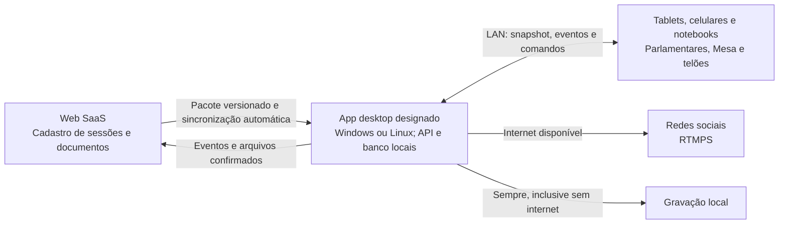

# ADR-027 — SaaS central com núcleo local para operação sem internet

**Status:** direção funcional definida pelo usuário; desenho técnico e implantação pendentes · **Data:** 06/11/2026. Este documento não habilita votação offline nem altera o aceite do piloto. Complementa o [ADR-001](ADR-001-adaptacao-arquitetura-sandbox.md), que adiou o agente local, e a [fase 050](../etapas/050-sigilo-continuidade-excepcional.md), que hoje suspende atos digitais durante perda de conectividade.

## Problema e objetivo

Uma VPS pode hospedar o SaaS de várias Câmaras, com isolamento por `tenantId`, PostgreSQL, serviços de tempo real, administração, portal e backup. Ela não consegue sustentar uma sessão oficial quando a Câmara perde a ligação com a internet. O usuário definiu que **toda sessão e seus documentos são cadastrados pela web, importados automaticamente pelo aplicativo desktop e distribuídos por ele aos tablets, celulares e notebooks dos parlamentares**. O desktop conduz a sessão na rede local mesmo sem internet e sincroniza seus atos com o SaaS quando a conexão está disponível. Cada Câmara tem uma única instância desktop designada como autoridade da sessão; cópias independentes não podem votar e depois mesclar resultados.

Uma VPS é um ponto de partida de implantação, não um compromisso de capacidade para todas as Câmaras. Antes da expansão, medir sessões simultâneas, conexões de telão/portal, largura de banda, backup/restauração e disponibilidade; separar banco, armazenamento e redundância conforme a carga observada. O isolamento lógico por `tenantId` precisa continuar comprovado em APIs, arquivos, eventos e backups.

## Topologia proposta

| Camada | Responsabilidade | Condição sem internet |
|---|---|---|
| Web SaaS | Cadastra todas as sessões, pauta, documentos, matérias e regras aprovadas; distribui versões e recebe atos concluídos | Mostra último estado sincronizado com aviso de atraso; não aceita comandos para sessão sob autoridade do desktop |
| App desktop designado (Windows ou Linux) | Importa pacote completo, hospeda API/banco e tempo real da Câmara, conduz a sessão, atende dispositivos na LAN, grava e sincroniza | Mantém operação na LAN, desde que energia, desktop e rede local permaneçam disponíveis |
| Dispositivos dos parlamentares | Obtêm sessão e documentos do desktop; fazem presença, fala e voto pelo servidor local autorizado | Continuam pela LAN, mesmo sem internet; isolados do desktop não produzem ato oficial |

O app desktop designado é também o **servidor local** da Câmara: deve rodar continuamente como serviço do Windows ou Linux, mesmo que a janela da Mesa seja fechada. Recomenda-se máquina dedicada, armazenamento e energia protegidos e procedimento de reserva; se esse computador dormir ou desligar, os dispositivos perdem a sessão. A instância central é multi-tenant; o desktop armazena **apenas um tenant**. O primeiro piloto técnico deve usar o mesmo domínio de comandos do servidor atual, mas o empacotamento desktop, a API na LAN e o protocolo de sincronização são novas entregas. Nenhum banco PostgreSQL ou SQLite será replicado por cópia de tabelas entre centro e Câmara.

O acesso na LAN também precisa de TLS, identidade de dispositivo, usuário nominal, autorização por papel, expiração de credenciais offline e trilha auditável. O endereço local deve funcionar sem DNS externo; certificados confiáveis nos dispositivos precisam estar provisionados antes da sessão. A Câmara deve poder revogar dispositivos perdidos quando houver conexão; durante uma desconexão prolongada, a janela de autorização previamente aprovada limita esse risco. O desktop guarda chaves fora do banco e requer backup conjunto de banco e arquivos, criptografia do armazenamento e restauração ensaiada. Esses mecanismos entram no modelo de ameaça da fase 050.

## Autoridade e sincronização

1. **Preparação exclusivamente na web:** secretaria cadastra sessão, matérias, pauta, convocação, anexos, documentos e participantes no SaaS. Cada mudança gera versão imutável. O desktop procura alterações automaticamente quando online, baixa metadados e **todos os bytes necessários** para aquela sessão, confere SHA-256 e confirma por item. O pacote inclui `tenantId`, `sessionId`, revisão da pauta, documentos e anexos, composição, vínculos, regras regimentais aprovadas, usuários/dispositivos autorizados e versão de esquema. URL externa ainda não baixada ou arquivo divergente deixa a sessão como **não pronta localmente**. O operador vê `sincronizando`, `pronta`, `alterações pendentes` ou `erro`, com última sincronização e itens faltantes.
2. **Congelamento para abrir:** a Mesa escolhe uma revisão preparada e o desktop confirma pacote íntegro antes da abertura. Uma alteração feita na web enquanto a sessão está ativa não substitui silenciosamente a pauta ou os documentos nos dispositivos; entra como nova revisão pendente de comando formal de incorporação, ciência exigida e trilha de auditoria. Sem internet, sessões e regras não importadas não são criadas como atos oficiais.
3. **Distribuição aos dispositivos:** tablet, celular ou notebook autenticado conecta-se ao endereço local do desktop. Recebe primeiro snapshot da sessão e manifesto de documentos; em seguida recebe eventos em tempo real com cursor/versão. Ao reconectar, pede eventos desde o último cursor e, se houver lacuna, baixa novo snapshot. PDFs podem ficar em cache para leitura, mas presença e voto são comandos enviados à API local; o desktop só responde sucesso após persistir. Repetição usa `commandId` idempotente. Não há sincronização direta entre dispositivos nem base oficial em cada tablet.
4. **Durante a sessão:** o desktop é o único escritor de presença, fala, votação, apuração, telão e encerramento daquela sessão. O centro rejeita mutações concorrentes, mesmo se a internet retornar no meio da sessão. Cada comando tem ator, dispositivo, `commandId`, versão esperada, horário observado e resultado. O desktop grava transação, auditoria e evento de saída antes de confirmar ao cliente.
5. **Desktop → web:** com internet, a fila local envia eventos ordenados por `(tenantId, sessionId, sequência)` e arquivos por partes com hash; o centro valida identidade, versão, encadeamento, idempotência e regras, persiste e devolve o maior número confirmado. Sem internet, a fila permanece durável. Divergência entra em quarentena para conferência humana; **não** se resolve votação por “última gravação vence”. O portal mostra estado e horário da última sincronização, sem fingir transmissão em tempo real.
6. **Fechamento e publicação:** o resultado é conferido localmente e no centro. A publicação externa e a integração futura com outros sistemas exigem reconciliação concluída e o fluxo de aprovação correspondente. Um ACK de transporte não equivale a aceite da ata nem a assinatura institucional.
7. **Recuperação:** a autoridade de uma sessão não migra automaticamente para outro desktop. Restaurar backup ou ativar reserva exige procedimento de promoção com bloqueio do anterior, identificação de último evento confirmado e conferência de lacunas, para impedir dois líderes.

### Fonte de verdade por etapa

| Dado ou ato | Antes da sessão | Durante a sessão | Depois de reconciliar |
|---|---|---|---|
| Cadastro, pauta, documentos e regras | Web; desktop importa revisões e bytes | Revisão escolhida fica congelada; alteração exige incorporação formal | Web preserva histórico de revisões e atos locais |
| Presença, falas, votos, apuração e telão | Ainda não existem | Desktop designado é autoridade exclusiva | Web guarda réplica verificada, portal e auditoria consolidada |
| Documentos produzidos na sessão, ata e gravação | Modelos podem vir da web | Produzidos/guardados localmente | Enviados com hash; publicação depende de revisão e aprovação |

### Sincronização automática observável

| Fluxo | Gatilhos | Confirmação e falha |
|---|---|---|
| Web → desktop | Inicialização do serviço, aviso de nova revisão, verificação periódica, retorno da internet e comando **Preparar sessão** | Confirma versão e SHA-256 de cada arquivo; falha mantém revisão anterior e mostra item pendente; abertura oficial exige pacote completo |
| Desktop → dispositivos | Login, entrada na sessão, mudança de pauta/estado, retorno do Wi-Fi e reconexão do app | Snapshot inicial + eventos com cursor; dispositivo confirma versão apresentada; lacuna provoca novo snapshot; voto só tem êxito após ACK persistido no desktop |
| Desktop → web | Após cada transação local, em lotes enquanto online, retorno da internet e fechamento da sessão | ACK sequencial durável no centro; fila local só elimina o confirmado; erro ou conflito fica visível para operação e não modifica o resultado local automaticamente |

O aplicativo deve mostrar **versão preparada, último envio/recebimento, quantidade de eventos e arquivos pendentes e condição da LAN/internet**. “Conectado” não significa “sincronizado”: a tela só indica **Pronto para iniciar** quando a revisão escolhida e todos os documentos necessários foram verificados no desktop e distribuíveis na LAN. Antes de abrir, a Mesa confere esse estado e os dispositivos exigidos pelo procedimento da Câmara.

Esta é uma proposta de protocolo, não uma alegação de que o sistema atual já o implementa. O modelo de sessão/votação, idempotência e outbox existentes oferecem base, mas hoje as rotas, banco e workers presumem uma instalação central. Extrair um núcleo local exige trabalho de produto, segurança e testes de falha próprios.

### Relação com o código atual

- `Session`, `SessionAgendaRevision` e `SessionDocument` já representam sessão, revisões e PDFs versionados. O pacote desktop deve incluir os bytes de `SessionDocument.content`, a revisão de `documentManifestJson` e todas as matérias/anexos referenciados. `MatterAttachment` hoje pode guardar apenas uma URL; nesse caso, o importador precisa obter uma cópia verificável e durável ou bloquear a prontidão offline.
- `OutboxEvent`, a auditoria e os `commandId` de presença/voto são bases úteis para entrega e repetição segura, mas não são um protocolo de sincronização centro ↔ desktop. Faltam sequência local, ACK persistente, pacote assinado, propriedade da sessão e detecção de divergência.
- As rotas `/api/v1/me/*` já associam o voto ao parlamentar autenticado. O app dos parlamentares deve manter essa regra ao apontar para a API local do desktop; não deve aceitar `parliamentarianId` informado pelo dispositivo.

## Comportamento por falha

| Falha | Sessão, votação e telão | Gravação | Portal e transmissão social |
|---|---|---|---|
| Internet da Câmara indisponível; LAN e desktop ativos | Sessão importada continua no desktop, se a fase offline for aprovada e homologada | Continua localmente | Portal fica atrasado; live social interrompe ou não inicia |
| SaaS central indisponível; internet e LAN ativos | Sessão importada continua no desktop | Continua localmente | Portal central indisponível; destino social pode funcionar direto do desktop se a plataforma estiver acessível |
| LAN entre dispositivo e desktop indisponível | Dispositivo isolado não vota nem comanda sessão | Desktop pode continuar gravando | Aplicar contingência regimental; sem fusão automática de votos posteriores |
| Desktop ou energia indisponível | Atos digitais param até recuperação ou promoção controlada | Depende do gravador independente | Operador comunica e segue procedimento de suspensão |
| Internet retorna | Sessão permanece sob autoridade local até encerramento; sincronização em paralelo | Arquivos são transferidos com hash e retomada | Portal recebe eventos confirmados; operador verifica o destino social antes de republicar link |

Transmissão para redes sociais requer internet em algum ponto do caminho. Um enlace secundário, como 4G/5G, pode reduzir interrupção, mas não transforma a rede social em serviço offline. A gravação local e o replay posterior são os recursos de continuidade que podemos garantir dentro da Câmara.

## Cliente e stack inicial

- **App desktop servidor:** empacotar para Windows e Linux a interface da Mesa e um serviço local independente da janela, com API, tempo real, mídia, armazenamento de documentos e fila de sincronização. Avaliar **Tauri 2** como interface e instalador, com serviço/sidecar controlado e atualização apenas fora de sessão. O banco transacional local deve ser escolhido em protótipo de concorrência, falha de energia, backup e instalação nos dois sistemas; PostgreSQL preserva o motor alvo atual, enquanto SQLite local simplifica a distribuição, mas exige validação específica. A sincronização usa eventos de domínio, não réplica física do banco. [Tauri: pré-requisitos](https://v2.tauri.app/start/prerequisites/), [sidecars](https://v2.tauri.app/develop/sidecar/) e [atualizador](https://v2.tauri.app/plugin/updater/).
- **Dispositivos dos parlamentares:** interface web responsiva/PWA servida pelo desktop na LAN, reaproveitando o módulo `/me` e suas regras de vínculo parlamentar. Tablets, celulares e notebooks não precisam instalar banco ou serviço local. O cache pode preservar PDFs para leitura, mas comandos oficiais dependem de resposta persistida pelo desktop. Service workers ajudam na leitura offline do dispositivo, sem garantir sincronização permanente em segundo plano. [MDN: operação offline](https://developer.mozilla.org/en-US/docs/Web/Progressive_web_apps/Guides/Offline_and_background_operation) e [cache](https://developer.mozilla.org/en-US/docs/Web/Progressive_web_apps/Guides/Caching).
- **Dados locais:** se o protótipo escolher SQLite para o desktop servidor, o arquivo de banco e o WAL ficam no mesmo computador; tablets e notebooks acessam somente a API local. O WAL do SQLite exige conexões no mesmo host, reforçando a proibição de compartilhar arquivo de banco pela rede. [SQLite: WAL](https://www.sqlite.org/wal.html).

## Ordem de desenvolvimento e gates

| Ordem | Entrega | Prova de saída |
|---:|---|---|
| 1 | Detalhar cadastro web obrigatório, importação completa automática e atos permitidos sem internet; definir duração máxima e procedimento regimental | Contrato de dados/documentos e regras assinados; voto secreto permanece projeto distinto |
| 2 | Extrair comandos determinísticos e contratos de pacote/eventos, sem mudar resultado do SaaS atual | Mesmos casos de presença/voto/ata passam na web e no desktop de teste |
| 3 | App desktop servidor Windows/Linux, pacote de sessão assinado, banco e API local | Sessão e todos os documentos importados com hash; alteração web aparece como revisão pendente, sem troca silenciosa |
| 4 | Dispositivos na LAN: autenticação, snapshot, documentos, eventos, cursor e comandos idempotentes | Tablet, celular e notebook acompanham a mesma sessão; perda/retorno de Wi-Fi recompõe o estado; isolado não vota |
| 5 | Sincronização desktop → web com sequência, ACK, deduplicação, validação, quarentena e transferência de arquivos | Queda e retorno em cada ponto; nenhuma duplicação ou divergência silenciosa; ata/portal reconciliados |
| 6 | Instaladores assinados, serviço automático Windows/Linux, atualização e rollback | Instalação e uso em ambos os sistemas; fechar a janela não derruba a sessão; atualização não ocorre durante sessão |
| 7 | Mídia local, gravação, retorno do link social e ensaio longo com falhas | Vídeo/áudio e replay íntegros; perda de internet visível; observação externa após retorno |
| 8 | Homologação institucional do modo offline | Teste presencial com equipe, LAN, energia, desktop de reserva, recuperação, apuração independente e aceite por área |

**Impacto no plano:** web como origem da preparação, desktop como servidor de sessão e sincronização automática com dispositivos são requisitos do produto definidos pelo usuário. A operação offline oficial permanece bloqueada até a fase 050 ser construída e homologada. Falta decidir se o primeiro piloto incluirá esse modo ou seguirá conectado com contingência de suspensão. Em ambos os casos, Nextcloud e Alfresco continuam após o piloto; a reconciliação de sessão precisa estar estável antes de conectores documentais.

## Decisões ainda abertas

1. O primeiro piloto de Mucuri deve incluir votação sem internet, ou começar conectado com contingência de suspensão enquanto o desktop local é homologado?
2. Quantas horas a Câmara deve suportar desconexão e quais atos podem ser iniciados nesse período?
3. O computador servidor será fornecido e mantido pelo edocBR ou pela Câmara? Qual o procedimento de reserva e acesso físico?

Até essas decisões e os gates técnicos passarem, a regra em vigor continua a da fase 050: sem internet, suspender os atos digitais que dependem do servidor central.
